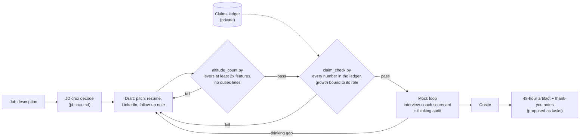

# career-agent-kit

Four Claude skills and two stdlib Python judges for a Director or VP job search, run like
a product launch with outside judges: decode the spec, build the launch artifacts, test
them against checks the model cannot argue with, run a beta with scored mocks, and follow
through after launch.

## The problem

I built this for my own search for senior product roles. Two things kept going wrong
with model-written materials. The drafts read a level too low: full of tools, tactics and
process, short on the bet and the business line. And the numbers drifted: each tailored
version rounded something up or moved a result to the wrong job, which is exactly what a
background check or a reference call catches. Prompting harder did not fix either one, so
I moved both checks out of the model and into scripts.

## How it works



| Launch step | Skill | Outside judge |
|---|---|---|
| Spec: what is the team really hiring to fix? | `job-loop-prep` step 0 | crux file has a line per top-6 bullet (eval 28) |
| Launch artifacts: pitch, one-pager, leave-behind | `job-loop-prep` | `altitude_count.py`, `claim_check.py` |
| Resume per target | `resume-tailor` | `claim_check.py`, `altitude_count.py --duties`, 30-eval suite |
| Public profile | `linkedin-profile-optimizer` | same two scripts on the proposed copy |
| Beta: scored mocks | `interview-coach` | scorecard with counts, never adjectives |
| Post-launch: follow-through | `job-loop-prep` follow-through | the 48-hour note passes the claim freeze |

The two judges:

- **`scripts/altitude_count.py`** tags each sentence as a lever (the bet, the moat, the
  business line, an outcome through the org), a feature (a tool, tactic, process step or
  metric mechanic) or neutral. The gate: levers at least 2x features. It also flags duties
  lines ("Responsible for...", "Led the team" with no outcome).
- **`scripts/claim_check.py`** reads a draft and a claims ledger and fails any number the
  ledger does not carry, any internal figure on an external surface, any growth number
  that does not name the role it happened in, any number placed under the wrong job, role
  dates that differ from the record, the candidate's known traps (bookings stated as
  revenue, a pilot stated as a launch, contractors counted as employees), and terms that
  did not exist yet when the role ended.

The question playbook the skills share (`references/playbook.md`) paraphrases public
methods by two practitioners, Nancy Chu and Simon Witten, with a citation on every row.

## Quickstart

Python 3.8 or later, no dependencies, no network.

```bash
# the pitch that passes both judges, and the first draft that fails them
python3 scripts/altitude_count.py examples/outputs/pitch.md --duties
python3 scripts/claim_check.py examples/outputs/pitch.md examples/claims-ledger.example.json
python3 scripts/altitude_count.py examples/outputs/pitch-v0-before.md --duties
python3 scripts/claim_check.py examples/outputs/pitch-v0-before.md examples/claims-ledger.example.json

# a resume, checked against the ledger
python3 scripts/claim_check.py examples/outputs/resume.md examples/claims-ledger.example.json

# the eval suite: every script grader must pass its pass fixture and fail its fail fixture
python3 evals/run_evals.py

# grade your own output against one eval (here: the duties lint)
python3 evals/run_evals.py --grade 24 examples/outputs/resume.md

# all tests
python3 -m unittest discover -s tests -v
```

To use it for yourself: copy `examples/claims-ledger.example.json` to `claims-ledger.json`
(git-ignored), replace the invented record with yours, and install the skills by copying
each `skills/<name>/` folder into your Claude skills folder with `references/` and
`scripts/` beside it.

## How it is verified

- **75 unit tests** across the two scripts and the eval runner, including the cases most
  likely to misfire: "GPT-4" and "Q3" are not numbers, "70-person" is; a bullet line does
  not become a section header; a number moves with the section header it sits under.
- **Lexicon calibration.** 40 invented developer-tools sentences, hand-tagged L, F or N
  before the lexicon was run on them. Agreement is 36 of 40 against a bar of 34, enforced
  by a test. Three misses fall to neutral (not counted) and one is a tie scored as feature;
  a second test fails if any miss ever adds a lever the hand tag did not have.
- **Eval suite.** `evals/resume-tailor.evals.json` ports the resume-tailor suite to an
  invented candidate: 30 evals, 54 binary assertions. 20 evals (24 assertions) are graded
  by script, and `run_evals.py` proves each grader on a passing and a failing fixture (40
  fixture checks, 0 wrong). The other 10 need a model or human judge, or a rendered .docx,
  and are listed rather than faked.
- **Drift test on the worked example.** The scorecard in
  `examples/outputs/interview-scorecard.md` quotes altitude counts; a test recomputes them
  so the example cannot drift from the script.
- **Sendable examples pass, the first draft fails.** The pitch, resume, LinkedIn About and
  48-hour note all pass both judges; `pitch-v0-before.md` fails both, for named reasons.

## Design decisions and tradeoffs

- **The judges live outside the model.** A model asked "are all your numbers right?" says
  yes. A script with a ledger cannot be persuaded. The cost is maintaining the ledger,
  which is also the point: it becomes the single source of truth for every surface.
- **Neutral sentences do not count.** The original counter scored a sentence with no
  signal as a lever, so filler padded the ratio. Here filler is tagged N and ignored, and
  ties go to feature. Harder to pass, harder to game.
- **Growth claims must name their role.** "Grew ARR from $18M to $63M" fails on its own;
  the same sentence under the employer's header, or with the employer named, passes. This
  catches the most common drift: a good number migrating to the wrong job.
- **Paraphrase, cite, and never ship the corpus.** The playbook rewrites each
  practitioner's method in my own words, credited by name and date. The raw notes stay
  private, and a method with no source row does not go into a skill.
- **Follow-through is proposed, never sent.** The skills emit tasks as JSON lines for an
  optional adapter. Nothing in the kit sends a message or writes to a task manager.
- **Lexicon over a classifier.** A regex lexicon is crude, but it is transparent, testable
  and free, and the calibration file shows exactly where it is wrong.

## Limitations

- The lexicon is English and general product vocabulary. Calibrate it on 40 sentences
  from your own material before trusting it; the shipped set was written by the same
  person as the lexicon, so 36 of 40 is a regression floor, not an accuracy claim.
- `claim_check.py` matches bare counts by value, so a "7" meaning years passes if a 7 in
  the ledger means product leads. Spelled-out numbers ("tripled") are not checked.
- Section context is a heuristic: a short line naming an employer opens that employer's
  section. Unusual resume layouts may need explicit employer names in each bullet.
- The kit does not build or render .docx files. Layout gates (page count, fonts, spacing)
  are a checklist in the resume-tailor skill, and their evals are listed as needing a
  rendered document.
- Internal prep files (the scorecard, the mock set, the crux file) are not meant to pass
  the claim freeze; only sendable drafts are.

## Layout

```
career-agent-kit/
├── skills/
│   ├── interview-coach/SKILL.md            scorecard, thinking audit, Stop/Start/Continue
│   ├── resume-tailor/SKILL.md              frame, crux, target level, claim freeze, gates
│   ├── linkedin-profile-optimizer/SKILL.md headline, About in three beats, change-not-duties
│   └── job-loop-prep/SKILL.md              crux, pitch, one-pager, mock set, follow-through
├── references/
│   ├── playbook.md                         question types and instruments, paraphrased and cited
│   └── claims-ledger.md                    ledger format and rules
├── scripts/
│   ├── altitude_count.py                   lever/feature/neutral counter, duties lint
│   └── claim_check.py                      claim freeze against a ledger
├── evals/
│   ├── resume-tailor.evals.json            30 evals, invented candidate
│   ├── run_evals.py                        script graders and fixture self-test
│   └── fixtures/                           pass and fail fixtures, one pair per graded eval
├── examples/
│   ├── candidate.md                        the invented candidate
│   ├── claims-ledger.example.json          the invented ledger
│   ├── jd-vp-product-platform.md           an invented JD
│   └── outputs/                            crux, pitch (before and after), resume, LinkedIn,
│                                           mock set, scorecard, 48-hour note, follow-up tasks
├── tests/                                  unit tests and the 40-sentence calibration set
├── CHANGELOG.md
└── LICENSE
```

Every person, company and number in `examples/`, `evals/` and `tests/` is invented.
